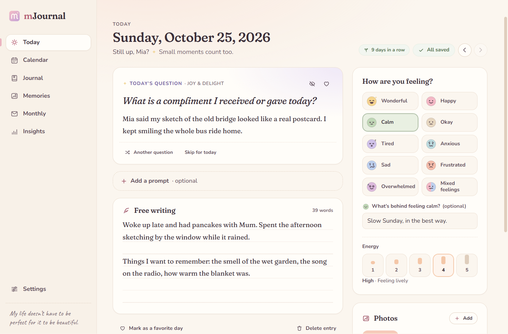
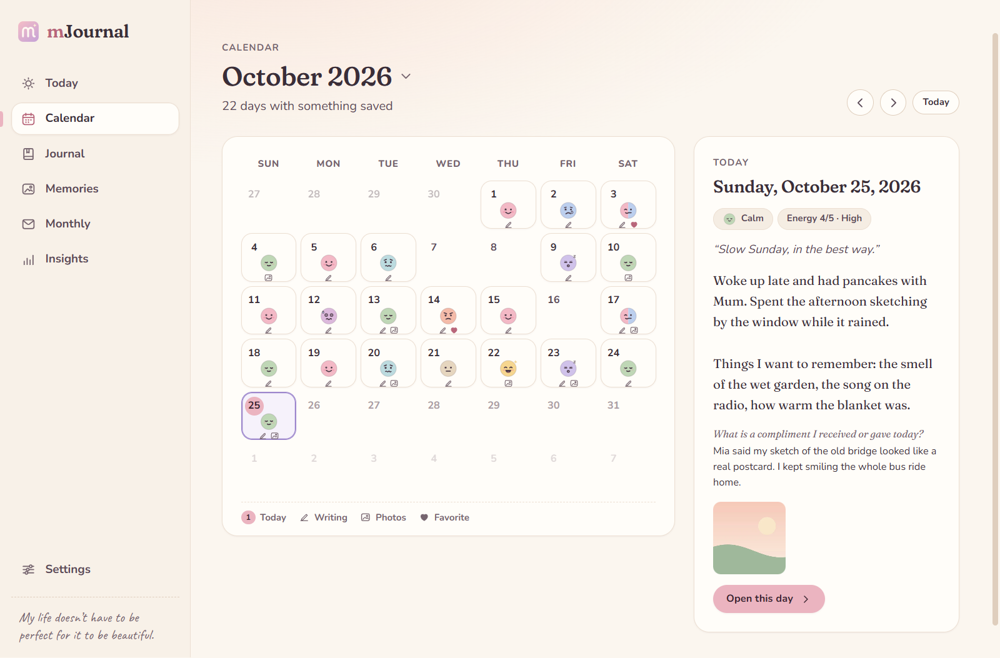
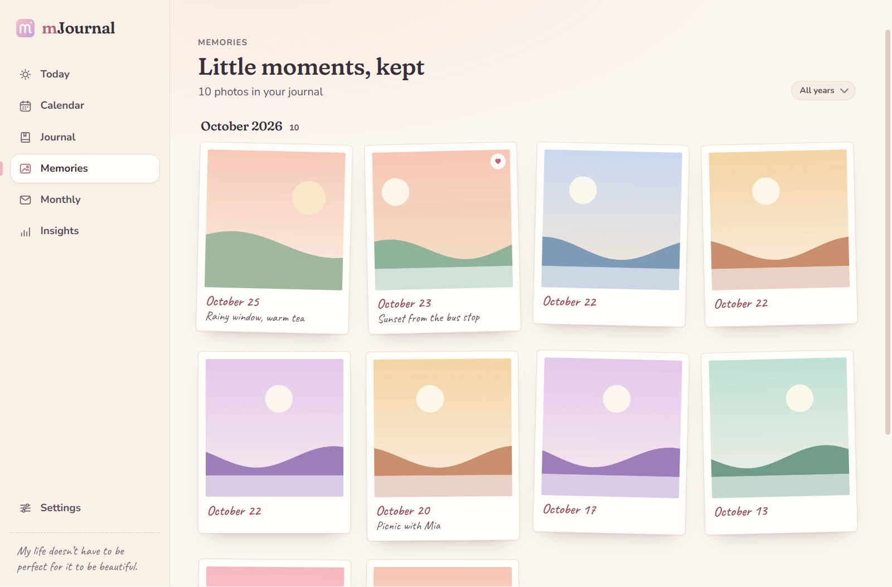
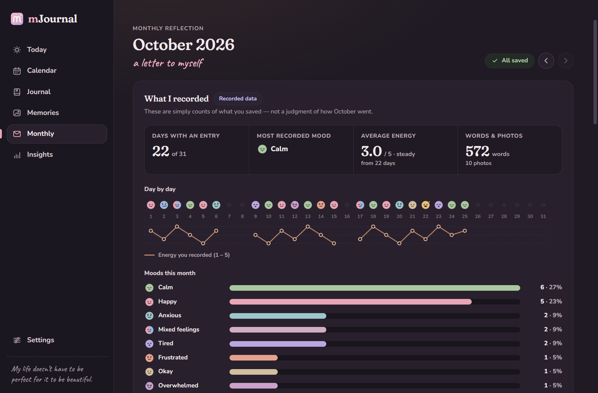
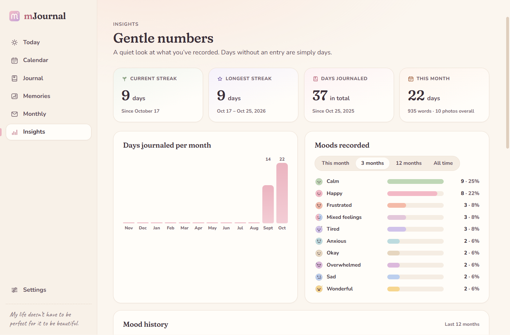

<p align="center">
  
</p>

<h1 align="center">mJournal</h1>

<p align="center"><em>My life doesn’t have to be perfect for it to be beautiful.</em></p>

mJournal is a private journal for your computer — a cozy place to notice the little things: a good conversation, a quiet
moment, something you’re proud of, a song that fit the day. It runs entirely on your laptop, needs no account, and
never sends your writing or photos anywhere.



## What you can do

- **Today’s page** — a warm greeting, a daily question that stays the same all day (ask for another one or skip it,
  no guilt), optional extra prompts from a library of 176 questions or your own, free writing on a lined page, and
  photos (drag them into a new order, or move one to another day from the photo viewer). Everything saves as you type,
  with a clear *Unsaved → Saving → Saved* indicator.
- **Questions asked every day** — pin up to three questions (“Three good things…”) to be asked on Today’s page every
  day, or on the weekdays you choose.
- **Mood & energy** — ten friendly moods (rename, reorder, hide or add your own), a 1–5 energy scale and an optional
  note. A mood on its own is enough for a day.
- **Tags** — tap a quick chip (*Family*, *Walk*, *Reading*… or your own) or write `#something` anywhere in a day.
  Journal finds days by tag, and a tag on its own is enough for a day too.
- **Trackers** — keep an eye on a few small things of your own (up to eight), next to your mood: *Went outside*,
  *Took my medicine* (yes or no) or *Sleep*, *Stress* (1 to 5). Answer them when you like; a day without an answer
  isn’t a “no”. A tracker you no longer need can be put away — its answers are kept.
- **Letters to the future** — write to yourself on a day that hasn’t come yet. The letter stays sealed (even
  mJournal doesn’t show it) until that day, then waits at the top of its page.
- **Quick note** — a shortcut that works anywhere on your computer (*Ctrl + Alt + J*, if you choose one), or *Quick
  note…* in the tray, opens a small box: the line goes to the end of today’s writing, with the time in front.
- **Drawings** — draw something with a mouse, a pen or your finger; it’s kept with the day’s photos.
- **In the tray, and at sign-in** — if you like, closing the window keeps mJournal in the tray, and it can open in the
  background when you sign in, so the evening reminder and the quick note are always there.
- **Calendar** — a month view with moods and small markers for writing, photos and favorites. Jump to any month or
  year, preview a day, open it. Days without an entry simply stay plain.
- **Journal** — every saved day, newest first, with local full-text search and filters for dates, month, mood, tags,
  photos and favorites. Put words in quotes to find them together (`"long walk"`) and a minus before a word to leave
  it out (`walk -rain`). Search also finds monthly and yearly reflections and letters that have opened, and a result
  opens with its matches marked on the page.
- **Memories** — a scrapbook-style gallery of your photos by month, with captions and a larger viewer that links
  back to the day.
- **Monthly** — a letter to yourself: an intention for the month (it shows on Today), what you recorded (clearly
  labelled as data, trackers included), the month’s photos, a few moments picked by simple published rules, and
  your own reflection.
- **Year in review** — a letter about the whole year: what you recorded, the year in moods, month by month with each
  month’s intention, moments, photos, tags and your own reflection. From 15 December, Today points to it.
- **Insights** — gentle numbers: an optional streak, days per month, mood history, moods by weekday, average energy
  (also by mood), words and photos per month, tags, trackers (also month by month) and a year in moods. No points,
  no penalties.
- **Backups** — complete backups in one file, made by hand or automatically into a folder you choose, optionally
  protected with a password; a careful restore; JSON and CSV export; and daily safety snapshots you can go back to.
- **An optional PIN** — mJournal asks for it whenever it opens, after a while without use, and when your computer goes
  to sleep. *Ctrl+L* locks it right away.
- **A welcome guide** — five short steps on the first start: your name, how a day works, where things live, privacy,
  and your theme and font. Skip it any time, and open it again from *Settings → Guide & tips*. After the guide, each
  page shows one small tip until you click *Got it*.
- Light and dark (“evening journal”) themes, three writing fonts, five text sizes (*Ctrl + =* and *Ctrl + −*) and
  keyboard shortcuts.
- Gentle animations: pages slide in, cards appear one after another, and little sparkles or hearts show up when you
  pick a mood, favorite something or save your first words of the day. They switch off with your system’s setting
  for fewer animations (on Windows, *Animation effects*) or *Settings → Appearance → Reduce motion*.
- For Windows and Linux.

<table>
  <tr>
    <td></td>
    <td></td>
  </tr>
  <tr>
    <td></td>
    <td></td>
  </tr>
</table>

## Install and open

### Download

Get the newest version from the **[Releases page](https://github.com/LucaBarbaLata/mJournal/releases/latest)**.

**Windows 10 or 11**

- **`mJournal-Setup-<version>.exe`** — installs mJournal for your Windows user (no administrator rights needed) with a
  Start menu entry and a desktop shortcut. *Recommended for everyday use.*
- **`mJournal-<version>-portable.exe`** — runs without installing. It starts a little more slowly because it unpacks
  itself each time, and it leaves nothing behind on the computer: it doesn’t open when you sign in, can’t show the
  evening reminder (Windows only shows notifications from installed apps) and can’t update itself.

Then open mJournal from its desktop shortcut or the Start menu (or double-click the portable `.exe`).

**Linux (64-bit Intel/AMD)**

- **`mjournal_<version>_amd64.deb`** — installs mJournal into the app menu on Ubuntu, Zorin OS, Linux Mint, Debian and
  other systems based on them. Double-click it to open it in your software installer, or run
  `sudo apt install ./mjournal_<version>_amd64.deb`. *Recommended on those systems.*
- **`mJournal-<version>.AppImage`** — one file that runs on most other distributions without installing. Allow it to
  run first: right-click → *Properties* → *Permissions* → *Allow executing file as program* (or
  `chmod +x mJournal-<version>.AppImage`), then double-click it.

**Checking a download:** `SHA256SUMS.txt` on the same page lists every file’s checksum. On Windows,
`Get-FileHash .\mJournal-Setup-<version>.exe` in PowerShell should print the same value; on Linux, run
`sha256sum -c SHA256SUMS.txt --ignore-missing` in the download folder. The release notes also link to
VirusTotal’s scan of both Windows files.

> **“Windows protected your PC”** — Windows shows this for apps that aren’t code-signed. Choose **More info →
> Run anyway**. mJournal isn’t signed because signing certificates cost money every year, which doesn’t fit a free
> hobby project. Every release is built from this source code by GitHub Actions
> ([.github/workflows/release.yml](.github/workflows/release.yml)), so you can see exactly what went into it.

### Build it yourself with one double-click

1. Double-click **`Build mJournal.cmd`** in this folder.
   The first build downloads about 300 MB of tools and takes a few minutes. If Node.js isn’t installed, a private copy
   is downloaded into `.tools\` (checked against its official checksum) — nothing is installed system-wide.
2. When it finishes, the `release` folder opens with the same two files as on the Releases page.

**On Linux**, open a terminal in this folder and run `bash build-mjournal.sh`. It works the same way: if Node.js 22.12
or newer isn’t installed (Ubuntu-based systems ship an older one), a private copy is downloaded into `.tools/`. The
`.deb` and the AppImage end up in `release/`.

### Updating

Each time it starts, and about once a day while it stays open, mJournal asks GitHub whether a newer version is out,
and if so a small note appears in the sidebar. Nothing is downloaded until you click **Update** (in the note, or in
**Settings → Updates**). mJournal then downloads the new version from the Releases page, checks it against the
release’s `SHA256SUMS.txt`, installs it and opens again — and your journal **stays as it is**:

- **Installed on Windows:** mJournal closes, the installer updates it in the same folder without showing its windows,
  and opens it again. If you installed it for all users, Windows asks for permission first.
- **AppImage:** the new AppImage takes the old one’s place, under the same file name, and starts.
- **`.deb`:** your system asks for your password, then the package is installed and mJournal starts again.
- **Portable version:** it can’t replace itself, so *Get it* opens the Releases page in your browser instead; replace
  the old file with the new one.

Afterwards a window tells you whether the update worked. If it didn’t, it says why when mJournal knows, and offers to
try again or to get the new version from GitHub.

You can turn the check off, or check right away, in **Settings → Updates**.

### For developers

```powershell
npm ci
node node_modules/electron/install.js   # fetches the Electron runtime (otherwise done on first run)
npm run dev                              # live-reloading app; uses %APPDATA%\mJournal-dev (Linux: ~/.config/mJournal-dev), never your real journal
```

See [Development](#development) for tests and builds.

## Where your journal is stored

| What                                        | Where on Windows                                                        | Where on Linux                  |
| ------------------------------------------- | ----------------------------------------------------------------------- | ------------------------------- |
| Your journal: database, photos, backups     | `%APPDATA%\mJournal` — e.g. `C:\Users\<you>\AppData\Roaming\mJournal`   | `~/.config/mJournal`            |
| Browser-engine cache (no journal content)   | `%LOCALAPPDATA%\mJournal\Chromium`                                      | `~/.cache/mJournal/Chromium`    |

Inside the journal folder:

| Path                              | Contents                                                                               |
| --------------------------------- | -------------------------------------------------------------------------------------- |
| `mjournal.db`                     | SQLite database: days, moods, answers, monthly reflections, settings, photo references |
| `lock.json`                       | Only if you set a PIN: a scrambled (hashed) form of it — never the PIN itself          |
| `backup-key.json`                 | Only if you protect backups with a password: the key made from it — never the password |
| `photos\`                         | Copies of your photos, named after their content (identical photos are stored once)    |
| `thumbnails\`                     | Small previews — only a cache, safe to delete                                          |
| `backups\automatic\`              | Daily safety snapshots of the database and copies made before upgrades                 |
| `backups\previous-journal-…\`     | Your previous journal, kept whenever you restore a backup                              |
| `logs\mjournal.log`               | A small technical log. It never contains your writing, moods, captions or photos       |

**Settings → Data & privacy** shows the exact path and has an *Open data folder* button.

- **Portable mode:** create a folder named `mJournal Data` next to `mJournal-<version>-portable.exe` (or next to the
  AppImage on Linux) and mJournal keeps everything inside it — handy for a USB stick. mJournal then doesn’t stay in the
  tray or open when you sign in, so it’s never left running when the stick is unplugged. Keep backups on another drive.
- **Another location:** set the environment variable `MJOURNAL_DATA_DIR` to a folder before starting mJournal.
- **Uninstalling never deletes your journal.**

## Backups, restore and export

All of these live in **Settings → Backup & export**.

- **Complete backup** — *Create backup…* writes one file, `mJournal-backup-YYYY-MM-DD-HHMM.zip`, containing a
  manifest, a consistent copy of the database and every photo. Keep it somewhere else: a USB drive, another disk.
- **Automatic backups** — switch them on, choose a folder (a USB drive, another disk, or a folder your own sync app
  looks after) and pick *every day* or *every week*. mJournal writes `mJournal-auto-backup-….zip` there by itself
  while it's open, catches up a minute after starting if a backup was due while it was closed, and keeps the newest
  5, 10 or 20 — it never touches any other file in that folder. If the folder can't be reached (an unplugged drive),
  Settings says so and mJournal tries again every hour. When there has been no complete backup for a month, Today
  gently suggests one.
- **A password for backups** — with *Set a password…*, every new backup (by hand or automatic) is encrypted
  (AES-256-GCM, with a key made from your password by scrypt) and gets the `.mjbackup` extension. On this computer,
  restoring one doesn't ask for the password; anywhere else it does. **There is no way to recover a forgotten
  backup password** — keep it somewhere safe. Changing or removing it only affects new backups.
- **Restore** — *Restore…* first checks the backup: every file name must be one mJournal expects (no hidden or
  absolute paths, no links), every file must match its SHA-256 checksum, and the database must pass SQLite’s
  integrity check. You then see what’s in it next to what you have now, and nothing changes until you confirm.
  Restoring **replaces** your journal — it does not merge. Your current journal is moved, not deleted, to
  `backups\previous-journal-…`, so you can always go back.
- **Daily safety snapshots** — once a day mJournal keeps a copy of the database in `backups\automatic`, also when it
  stays open for days (it checks every hour and after the computer wakes up). The newest copy of each of the last
  7 days, 4 weeks and 6 months is kept, so a mistake noticed weeks later can still be undone. Photos aren’t copied
  there because mJournal never deletes them silently. *Restore a snapshot…* puts one back: it's checked first, your
  current database is moved to `backups\previous-journal-…`, and your photos stay as they are.
- **Export** — *JSON* contains everything in a structured form; *CSV* has one row per day and opens in a spreadsheet.

## Privacy

- **Local only.** No account, no cloud sync, no analytics, telemetry or ads. Your writing, moods and photos never
  leave your computer; fonts and icons are bundled, and search, statistics and backups all run locally.
- **One question to the internet.** The only request mJournal makes by itself is the update check: when it starts,
  and about once a day while it stays open, it asks GitHub (`api.github.com`) which version was released last. Like any web request it reveals your IP address
  to GitHub, but it carries nothing about you or your journal — no cookies, no ids, just “mJournal”. Clicking
  **Update** downloads the new version from GitHub’s Releases page, just as anonymously. Turn the check off in
  **Settings → Updates** and mJournal never goes online unless you click *Check now* or *Update*.
- **Not encrypted at rest.** Your journal is stored as ordinary files in your user folder. Anyone who can sign in to
  your account — or read your disk — can read them. Protect it with a password on your account and turn on disk
  encryption: on Windows, *BitLocker* or *Device encryption* in Windows settings; on Linux, full-disk encryption, which
  is usually set up while installing the system. Backups are encrypted only if you set a password for them
  (*Settings → Backup & export*); exports never are, so keep them somewhere private.
- **The PIN keeps mJournal closed, not encrypted.** With a PIN (*Settings → PIN lock*), mJournal shows only its lock
  screen until the right PIN is entered: nothing of your journal is loaded, and the part of mJournal that reads your
  files refuses to while it’s locked. That keeps out people who use your computer while you’re away. It isn’t
  encryption: someone who can open your files directly could still read them, so the advice above still applies. The
  PIN is stored only as a salted *scrypt* hash, in `lock.json` — not in backups, so restoring one never changes your
  PIN. After five wrong tries mJournal asks for a pause, which grows to 15 minutes, even across restarts.
- **Careful by design.** The interface runs in a sandbox with a strict content-security policy and can only call a
  fixed list of functions, each of which validates its input. Photos are served by id, never by file path. New
  windows, navigation and permission requests (camera, microphone, location…) are blocked. In the built app,
  Electron’s security switches prevent it from being run as a plain Node.js program, from being debugged via command
  line flags, and from loading code other than its own verified package.

Found a security problem? Please report it privately, as described in [SECURITY.md](SECURITY.md).

## How mJournal counts things

- A day counts as **journaled** when anything was saved for it: a mood, energy, some words, a photo, a tag or a
  tracker’s answer (a “no” too: it was recorded).
- **Trackers** count only the days you answered them: *Yes on 12 of 18 days* for a yes-or-no tracker, the average
  of your answers for a 1-to-5 one. A tracker with answers can be put away but not deleted, so a day keeps what was
  recorded on it.
- **Deleting a day** moves it to *Settings → Recently removed* (with an *Undo* right away), like a removed photo.
  Restoring never overwrites anything written on that day since: different text is added after a blank line.
- Your **current streak** is the number of days in a row up to today. If today is still empty, a streak that ended
  yesterday still counts — the day isn’t over. A missed day is simply a day without an entry.
- The **daily question** is chosen from the date, avoiding questions shown in the 90 days around it, and is remembered
  once shown — reopening the app never changes it.
- **Moments** in the monthly recap come only from: days you marked as favorites, answers you saved as favorite
  moments, your longest entry (40+ words) and days with three or more photos. mJournal never writes or guesses
  anything about how you felt.

## Troubleshooting

| Problem | What to do |
| --- | --- |
| “Windows protected your PC” | Choose **More info → Run anyway** (the app isn’t code-signed). |
| mJournal says it couldn’t open your journal | Nothing has been deleted. *Open data folder* to look around, or *Set it aside and start a new journal*: the database is moved to `backups\damaged-journal-…`, and you can then restore a complete backup from Settings. |
| “This journal was saved by a newer version of mJournal” | Your data is untouched. Install the newer version from the [Releases page](https://github.com/LucaBarbaLata/mJournal/releases/latest). |
| *Update* didn’t work | The window after the update (and **Settings → Updates**) says why, and *Get mJournal … from GitHub* opens the Releases page: download the installer (or the `.deb`, or the AppImage) and run it — that keeps your journal too. The AppImage can only replace itself if mJournal may save files in the folder it is in. |
| Settings → Updates says GitHub couldn’t be reached | You’re offline, or a firewall blocks `api.github.com`. Nothing else is affected; mJournal tries again a few hours later, and when it next starts. |
| Forgot your PIN | Close mJournal, open the data folder (see [Where your journal is stored](#where-your-journal-is-stored)) and delete `lock.json`. mJournal then opens without a PIN, and your journal is exactly as it was. Set a new PIN in *Settings → PIN lock*. |
| Forgot your backup password | Backups protected with it can't be opened — by design, nobody can. Your journal itself is unaffected: set a new password (or remove it) in *Settings → Backup & export* and make a new backup right away. On the computer that made them, protected backups still restore without the password as long as `backup-key.json` is there. |
| Automatic backups say the folder isn't available | The drive is unplugged or the folder was moved. Plug it in (mJournal tries again every hour) or choose another folder. |
| A photo shows “Photo unavailable” | Its file is missing from `photos\` (Settings → Data & privacy counts these). Restoring a complete backup brings it back. |
| iPhone photos (HEIC) are rejected | Save them as JPEG first — on the iPhone: *Settings → Camera → Formats → Most Compatible*; or open them in the Windows Photos app and *Save as* JPEG. |
| The evening reminder doesn’t appear | It only works while mJournal is running — open, minimized or kept in the tray. *Settings → Reminder & background* can keep it in the tray and open it when you sign in. It stays quiet on days you’ve already written, and can be hidden by Windows *Do not disturb*. The portable `.exe` can’t show it at all: use the installed mJournal. |
| Linux: no tray icon | Your desktop needs a tray area. On GNOME, turn on the *AppIndicator* extension (Zorin OS and Ubuntu include it). Without one, closing the window still hides it: start mJournal again from the app menu to bring it back. |
| The quick-note shortcut does nothing | Another app may already use it — *Settings → Reminder & background* says so; choose another one. Some Linux desktops (Wayland) don’t allow such shortcuts at all; *Quick note…* in the tray works either way. |
| `Build mJournal.cmd` or `build-mjournal.sh` fails | Check your internet connection (it downloads from npm, nodejs.org and GitHub), delete the `node_modules` folder and run it again. |
| Linux: double-clicking the AppImage does nothing | Allow it to run first: right-click → *Properties* → *Permissions* → *Allow executing file as program*, or `chmod +x mJournal-<version>.AppImage`. |
| Linux: the AppImage runs, but you’d like the full sandbox | Ubuntu 24.04 and systems based on it only let installed apps use the kernel feature Chromium’s sandbox needs, so there the AppImage starts with that sandbox switched off rather than not at all. Install the `.deb` instead: it sets the sandbox up properly. |
| Linux: no spelling suggestions | Spell checking is off on Linux for now: Chromium would download its dictionaries from Google, and mJournal doesn’t go online for that. |
| Something else | `logs\mjournal.log` in the data folder records technical errors (never journal content). |

## Development

**Requirements:** Windows 10 or 11, or 64-bit Linux, and Node.js 22.12 or newer (24 LTS recommended) — or let
`Build mJournal.cmd` / `build-mjournal.sh` fetch one.

| Command | What it does |
| --- | --- |
| `npm ci` | Installs the exact pinned dependency versions from `package-lock.json` |
| `npm run dev` | Starts the app with live reload (data in `%APPDATA%\mJournal-dev`) |
| `npm test` | Unit and integration tests (Vitest) — dates, streaks, prompts, database, photos, search, stats, exports, migrations, backup & restore |
| `npm run test:e2e` | Builds the app, then drives the real app with Playwright in throwaway data folders |
| `npm run typecheck` | Type-checks the main process, interface and tests |
| `npm run dist` | Builds the installer and the portable `.exe` into `release\` (on Windows) |
| `npm run dist:linux` | Builds the `.deb` and the AppImage into `release/` (on Linux) |
| `npm run icons` | Re-renders `build\icon.ico`, the PNG icons and the tray icons from `build\icon.svg` and `build\icon-small.svg` (`-- --tray-only` for just the tray icons) |
| `npm run notices` | Rewrites `THIRD-PARTY-NOTICES.txt` after dependencies change (a unit test reminds you) |
| `npm run verify` | Type-check, unit tests and end-to-end tests in one go |

On GitHub, the *Tests* workflow ([.github/workflows/ci.yml](.github/workflows/ci.yml)) runs `npm run verify` on Windows
and on Linux after every push to `main` and for every pull request. Dependabot proposes dependency updates every week
as pull requests, which the same workflow tests.

### Releasing a version

1. Raise the version (skip this for the first release, 1.0.0), then commit and push:

   ```powershell
   npm version patch --no-git-tag-version   # or minor / major: updates package.json and package-lock.json
   ```

2. On GitHub, open **Actions → Release → Run workflow** and pick what to make:
   - **draft** — only you can see it. Download and try the installers, then press *Publish release* on GitHub.
   - **pre-release** — public, but the app’s update check ignores it: a release candidate for testers.
   - **release** — public, and everyone’s mJournal mentions it in the sidebar.

[.github/workflows/release.yml](.github/workflows/release.yml) type-checks and tests everything on Windows and on Linux,
builds the installer and the portable app on Windows and the `.deb` and the AppImage on Linux, uploads the two Windows
files to VirusTotal, and puts all four on the Releases page with a `SHA256SUMS.txt` and links to the VirusTotal results
in the release notes. If either system’s tests or build fail, or the scan can’t be done, nothing is published. The scan
needs a free VirusTotal API key saved once as the repository secret `VT_API_KEY` (*Settings → Secrets and variables →
Actions*). The `v1.0.0`-style tag is
created when the release is published. Running it again for the same version replaces a draft. Running it with
**release** while that version is a pre-release turns the pre-release into the release, without building again, as
long as the app hasn’t changed since (edits to `.github/`, `docs/` and Markdown files don’t count). A version that is
already released stops right away and asks you to raise the version. The repository has to be public for people to
download releases and for the update check to see them.

### Stack

mJournal is an [Electron](https://www.electronjs.org/) app: a React + TypeScript interface on top of a small Node.js
core that owns the database and files. SQLite comes from Node’s built-in `node:sqlite` module, so there are no
compiled add-ons to build. The full reasoning, data model and security model are in
[docs/ARCHITECTURE.md](docs/ARCHITECTURE.md).

| Dependency | Why |
| --- | --- |
| `electron` | Desktop window and its own Chromium — works offline, looks the same everywhere |
| `react`, `react-dom` | Interface components |
| `yazl`, `yauzl` | Writing and safely reading backup `.zip` files |
| `@fontsource-variable/*` | Fraunces, Nunito and Caveat fonts, bundled so nothing loads from the internet |
| `electron-vite`, `vite`, `@vitejs/plugin-react`, `typescript` | Build tooling |
| `electron-builder` | Windows installer and portable `.exe`, Linux `.deb` and AppImage |
| `vitest`, `@playwright/test` | Tests |

All versions are pinned exactly in `package.json`.

### Project layout

```text
src/
  core/        Pure, tested logic shared by both sides: dates, moods, prompts, streaks, search, validation, API contract
  main/        Electron main process
    store/     SQLite access: migrations, entries, prompts, moods, photos, reflections, search, stats, settings
    services/  Photo files, backups, restore, snapshots, exports, the update check
    api.ts     Validates every call from the interface      host.ts  Owns the journal (and restores)
    index.ts   App start-up, data folder, window             protocols.ts  app:// and mj-media://
  preload/     The narrow bridge exposed to the interface
  renderer/    React interface: views/, components/, lib/, styles/ (design tokens in styles/tokens.css)
tests/unit/    Vitest tests          tests/e2e/   Playwright tests of the real app
build/         Icon sources and packaging resources
scripts/       Icon rendering, third-party notices and the Node.js downloads used by Build mJournal.cmd and build-mjournal.sh
.github/       The release and test workflows, Dependabot settings and the bug report form
```

## Known limitations

- The journal isn’t encrypted at rest (see [Privacy](#privacy)); the PIN keeps mJournal closed, not the files.
- Restoring a backup replaces the whole journal; there’s no merging of two journals.
- One entry per day (with any number of prompts and photos).
- HEIC/HEIF photos aren’t supported.
- The evening reminder needs mJournal to be running (keep it in the tray and let it open at sign-in to be sure). The
  portable `.exe` can’t show it.
- Built and tested on Windows 11. Linux packages (64-bit Intel/AMD only) are new in 1.1; they are tested automatically on
  Ubuntu 24.04 and were tried by hand on Zorin OS. macOS packaging is configured but hasn’t been tested.
- Spell checking isn’t available on Linux.
- The app isn’t code-signed, so Windows shows a SmartScreen warning the first time.
- The portable version can’t update itself: mJournal tells you about a new version, and you replace the file. It
  doesn’t open at sign-in either, and with a `mJournal Data` folder beside it (or beside the AppImage) mJournal doesn’t
  stay in the tray.
- The interface is in English.

## License

mJournal is free and open source under the [MIT License](LICENSE). It includes React and the Fraunces, Nunito and
Caveat fonts (SIL Open Font License), among others; their licenses are collected in
[THIRD-PARTY-NOTICES.txt](THIRD-PARTY-NOTICES.txt), which also ships next to the app’s executable.
