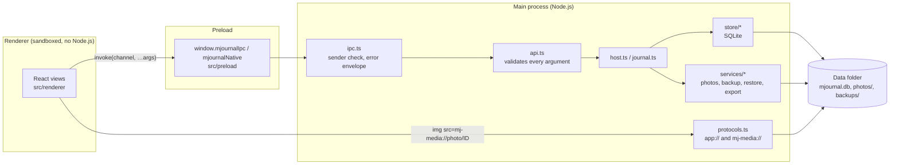

# mJournal architecture

This document is for developers working on mJournal. The [README](../README.md) covers installing and using it.

## Why this stack

mJournal is a desktop **Electron** app with a **React + TypeScript** interface and **SQLite** storage.

- **A designed interface.** The product depends on its look and feel (cream paper, soft type, hand-drawn moods,
  animation that respects reduced motion). HTML and CSS give full control over that, and Electron ships its own
  Chromium, so it renders the same on every machine and works offline.
- **Real local storage without a server.** The main process reads and writes the SQLite file and photo folder
  directly. There is no local web server and no open port; the interface talks to the main process over IPC only.
- **One-click distribution.** `electron-builder` produces a per-user installer and a portable `.exe` for Windows,
  and a `.deb` and an AppImage for Linux.
- **Testable end to end.** Playwright can drive the real app, so the important flows are tested as a user would use
  them.
- **No compiled add-ons.** SQLite comes from Node’s built-in `node:sqlite` (present in Electron 44’s Node 24), so
  `npm ci` never compiles native code, and unit tests run on the very same SQLite engine.

Alternatives considered: Tauri (needs a Rust toolchain, harder to drive with test automation), a localhost server with
the system browser (opens a port that other software could reach, and feels like a website), WPF/WinUI (Windows-only
and much harder to make look designed), Python with pywebview (depends on platform-specific bridges).

## Processes



- `src/core` is pure TypeScript with no Node.js or DOM APIs. It compiles under both the main-process and interface
  configs, so it can’t accidentally depend on either. It holds dates, streak rules, the prompt library and its
  selection, mood definitions, text helpers, input validation and the **API contract** (`core/api.ts`).
- `src/main/journal.ts`, `host.ts`, `store/*` and `services/*` don’t import Electron. Tests open real journals in
  temporary folders, including the complete backup → restore flow.
- Electron-specific code is limited to `main/index.ts`, `window.ts`, `protocols.ts`, `platform.ts`, `ipc.ts`,
  `reminders.ts`, `tray.ts` and `autostart.ts`.

### The API contract

`core/api.ts` defines `MJournalApi` (typed methods per namespace) and `API_METHODS` (the list of method names, checked
against the interface at compile time). The preload exposes exactly those methods; `main/ipc.ts` registers exactly
those channels; `main/api.ts` implements them, treating every argument as `unknown` and validating it with
`core/validation.ts`. Errors that are safe to show are `UserFacingError`s; anything else is logged (the error only,
never the arguments) and reported as a generic message.

## Data model (schema version 3)

All tables are SQLite `STRICT` tables. The schema version is `PRAGMA user_version`.

| Table | Purpose |
| --- | --- |
| `entries` | One row per calendar day (`date` = `YYYY-MM-DD`): free writing, mood key, mood note, energy 1–5, favorite. Derived columns (`word_count`, `has_text`, `answer_count`, `photo_count`, `favorite_moments`, `tag_count`, `tracker_count`) are refreshed in the same transaction as every change; `has_content` is a generated column and is the single definition of “this day counts” (writing, a mood, energy, a photo, a tag or a tracker's answer). |
| `answers` | Prompt answers per day, with a copy of the question’s wording (`prompt_text`) so edits to custom prompts never change old answers. |
| `photos` | Photo rows: day, content hash, stored file, caption, order, favorite, thumbnail flag, `removed_at` for “Recently removed”. No foreign key to `entries`, so deleting a day keeps its photos recoverable. |
| `daily_prompts` | The featured question shown for each date (saved on first view), with shuffle count and “skipped”. |
| `prompt_prefs` | Favorite / hidden flags for any prompt id. |
| `custom_prompts` | The user’s own questions (archived rather than deleted). |
| `moods` | The mood vocabulary: label, icon, color, order, hidden, built-in. Moods are hidden, never deleted. |
| `monthly_reflections` | Answers to the monthly questions, the “Dear me” letter and the month’s intention (`intention`), per month. |
| `yearly_reflections` | The same for a year (Year in review). |
| `tags` | The tag vocabulary: `name` (the key: the label in lower case), label, `quick` (shown as a chip on every day), order. |
| `entry_tags` | Tags on days: `picked` (tapped as a chip) and/or `written` (`#tag` in the day’s writing, answers, mood note or captions). `refresh()` keeps `written` in step with the text, drops rows that are neither, and removes tags that are neither quick chips nor used. |
| `removed_days` | Days deleted with *Delete entry*: their fields, answers and picked tags as versioned JSON, plus the photos that went to Recently removed with them (`store/removedDays.ts`). |
| `pinned_prompts` | Up to three prompts asked every day, with a weekday bitmask (bit 0 = Sunday). |
| `trackers` | Things answered each day: label, `kind` (`check`: 0 = no, 1 = yes; `scale`: 1–5), order, `archived` (“put away”). One with answers is never deleted and can't change its kind (`store/trackers.ts`); at most 8 are active. |
| `tracker_values` | A tracker's answer on a day (`entry_date`, `tracker_id`, `value`); deleted with its day (`ON DELETE CASCADE`), which keeps them in Recently removed first. |
| `capsules` | Letters to a future day: `open_on`, `written_on`, body, `opened_at`. Editable only on `written_on`; the body isn’t sent to the interface while sealed (`store/capsules.ts`, using the main process’s own date). |
| `writing_index` | FTS5 table for writing that isn’t part of a day: `kind` (`month`, `year`, `capsule`), `ref`, `text`. Sealed letters are never in it. |
| `settings` | JSON values per key, re-validated on read (malformed values fall back to defaults). Keys starting with `internal.` hold things like the window size. |

The PIN lock is deliberately **not** in the database: it lives in `lock.json` next to it (see *The PIN lock* below).
| `search_index` | FTS5 table (`body`, `answers`, `notes`), rowid = the day number of the date. |

### Migrations

`store/migrations.ts` holds an ordered list of migrations. On start-up:

1. If the database is from a **newer** version, mJournal refuses to open it and changes nothing.
2. If a migration is needed and the database already has data, a full snapshot is written to
   `backups/automatic/mJournal-before-migration-v<N>-<time>.db` first.
3. Each migration runs in its own transaction together with its `user_version` bump. A failure rolls back
   completely.
4. Derived columns and the search index are rebuilt.

**To change the schema:** append a new migration with the next version number. Never edit a released one. Add a
test next to the ones in `tests/unit/migrations.test.ts`.

Version 2 (mJournal 1.2) adds the tables above and changes what counts as a day. `has_content` is a generated column,
which SQLite can't alter, so the migration drops it and adds it again with the new rule — nothing else in the schema
refers to it, so no table is rebuilt (and no foreign-key cascade runs). After any migration, and after every restore,
`Journal.refreshDerived()` recalculates every day (picking up `#tags` already in old writing) and rebuilds both search
indexes.

Version 3 (mJournal 1.3) adds `trackers` and `tracker_values`, and `entries.tracker_count`; `has_content` is dropped and
added again the same way, so a tracker's answer on its own makes a day count. Days in `removed_days` written by 1.2
(`"v": 1`) have no trackers; 1.3 writes `"v": 2` with the day's tracker answers, which come back only for trackers
that still exist and only where the day has no newer answer.

## Important flows

### Saving while writing

`renderer/lib/saveQueue.ts` debounces edits per field (`body:<date>`, `answer:<date>:<prompt>`, …) for 650 ms, runs
saves for the same field in order, keeps failed saves for retry and drives the save indicator. Before the window
closes, the main process asks the interface to flush (`window.ts`, with a 3-second safety timeout).

SQLite runs in WAL mode with `synchronous = FULL`, so a committed save survives a crash or power cut.

### Photos

1. The main process reads the picked or dropped file (size limit 25 MB), identifies it by its first bytes (JPEG, PNG,
   WebP, GIF, AVIF; HEIC is recognised and politely rejected) and hashes it.
2. The bytes are written atomically to `photos/<first 2 hex>/<sha256>.<ext>` unless that file already exists.
   Identical photos are therefore stored once, and two photos can never collide.
3. The interface fetches the original through `mj-media://photo/<id>`, decodes it with Chromium (respecting EXIF
   orientation), scales it down and sends back a WebP thumbnail, stored as `thumbnails/<sha256>.webp`. Each finished
   thumbnail is announced to the photos showing it (`useThumbnailVersion` in `renderer/lib/thumbnails.ts`); the views
   reload their data once, when the queue is empty, so a large gallery doesn't reload once per photo. A restore starts
   with an empty `thumbnails/` folder, so it clears every `has_thumbnail` flag (`photos.forgetThumbnails()`), and a
   thumbnail that fails to load (the folder was deleted) is made again once per session.
4. Removing a photo sets `removed_at`. Deleting it permanently is a separate, confirmed step, and the file is only
   deleted when no other photo row uses it. Originals on the user’s disk are only ever read.
5. Photos can be reordered within a day (`photos.reorder`) and moved to another day (`photos.moveToDay`, which
   refreshes both days). Selections larger than `MAX_IMPORT_BATCH` (30, `core/photos.ts`) are sent in batches; a day
   holds up to 60 photos. Memories asks for `GALLERY_PAGE_SIZE` (120) photos at a time and grows the request as you
   scroll, so reloads keep everything that is already shown.

### Complete backup and restore

- `services/backup.ts → writeBackup` writes `mjournal-backup.json` (manifest with counts and SHA-256 of every file), a
  `VACUUM INTO` copy of the database and every referenced photo into a `.partial` file, flushes it, then renames it
  into place.
- `stageBackup` only accepts entry names from an allowlist, rejects links, encrypted entries, duplicates and oversized
  archives, cross-checks the archive against its manifest, extracts into `.tmp/restore-*` while verifying sizes and
  hashes, then opens the extracted database and runs `PRAGMA integrity_check`.
- `host.ts → restore` closes the journal, moves the current database and photos to
  `backups/previous-journal-<time>/`, moves the staged files in and reopens. If any step fails, every move is undone
  and the original journal is reopened. A restored backup clears every thumbnail flag (its thumbnails folder starts
  empty).
- **Snapshots** restore the same way (`host.inspectSnapshot`): the named file must be one listed in
  `backups/automatic`; a copy is staged, integrity-checked and counted, and `restore.ts → swapInDatabase` moves only
  the database aside — photos stay. `snapshots.ts → snapshotsToKeep` thins the daily copies to the newest of each of
  the last 7 days, 4 weeks and 6 months, by the date in their names; pre-upgrade copies are never pruned.

### Password-protected backups

`services/backupCrypto.ts` (plain `node:crypto`). A key is derived from the password with scrypt (N = 2¹⁷, r = 8,
p = 1, 16-byte salt). `writeBackup` then pipes the .zip through AES-256-GCM as it is written, so no unprotected copy
touches the disk:

```text
"MJBKENC1" | header length (uint32 BE) | header JSON {format, cipher, kdf, N, r, p, salt, nonce, check} | ciphertext | 16-byte tag
```

The whole header is authenticated as additional data. `check` is an HMAC of a constant under the key, so a wrong
password is recognised before anything is decrypted, and header values are range-checked before scrypt runs
(memory ≤ 512 MiB, header ≤ 4 KB). Restoring decrypts into `.tmp/decrypt-*`, then runs the usual `stageBackup`
checks; the decrypted copy is deleted either way. The key — never the password — is remembered in `backup-key.json`
beside the journal (outside the database, so never in a backup), which lets automatic backups be protected without
asking and lets this computer restore its own protected backups directly.

### Automatic backups

`services/backups.ts` (`Backups`, Electron-free) decides and writes; `index.ts` calls `runIfDue()` a minute after
start, every hour and after resume. The folder is an internal setting chosen only through a main-process folder
dialog, so the interface can't point backups at arbitrary paths. A backup is due 20 hours (daily) or 6½ days
(weekly) after the last one; only one is written at a time; files are named `mJournal-auto-backup-<stamp>.zip`
(or `.mjbackup`) and pruning only ever deletes files with that name, beyond the number to keep. Failures are kept in
`internal.autoBackupError` for Settings and cleared by the next success. `BackupStatus.remind` drives the reminder on
Today: at least 7 journaled days, no complete backup for 30 days, not snoozed (14 days).

### Search

- `core/search.ts` turns what is typed into a query: words match as prefixes, `"quoted words"` must appear together
  (the last one as a prefix), and `-word` / `-"a phrase"` leave days out (`(…) NOT (… OR …)`; exclusions alone find
  nothing). Only letters and digits survive and every term is quoted, so no FTS syntax from input reaches SQLite.
- Days are searched in `search_index` (writing, answers, mood notes, captions and tag labels). Monthly and yearly
  reflections and opened letters are in `writing_index` (`store/writingIndex.ts`), kept current in the same transaction
  as each save; `journal.searchWriting` returns them with snippets, filtered by the search's dates.
- A result opens its page with `?q=`. `findMatches()` finds the same words in the text (folding case and accents the
  way the index does), and `AutoTextarea`'s `highlight` draws them: a mirror of the text with `<mark>`s sits behind the
  transparent textarea, copying its computed font, padding and size, so the field stays fully editable. The
  `SearchBanner` counts the marks and steps through them.

### Year in review

`store/years.ts` (`YearStore.recap`) counts the year the way the monthly recap counts a month, adds each month's
intention, picks moments with the same rules (`store/moments.ts`, shared with the month; a year keeps at most six
favorite days, four favorite answers and two photo days, spread over the year), up to 12 photos (favorites first) and
the top tags. Its reflection lives in `yearly_reflections`. The page is `#/year/<year>` (`views/YearView.tsx`), reached
from Monthly, Insights and — from 15 December to 31 January — a card on Today.

### Tray, sign-in and the quick note

- **Tray** (`main/tray.ts`): shown while *Keep mJournal in the tray* is on (Open / Quick note… / Quit). `window.ts`
  then hides the window on close — after the interface has saved, like a real close — and `index.ts` locks it when a
  PIN is set. A `quitting` flag (set by `before-quit`, the tray's Quit, the update installer's `quitForUpdate`, Windows
  `session-end` and `powerMonitor` `shutdown`) makes closing really close. Turning the tray off brings a hidden window
  back. Tray icons are `resources/tray-16.png` and `tray-32.png`, rendered by `npm run icons`.
- **Sign-in** (`main/autostart.ts`): Windows uses `app.setLoginItemSettings` with the installed exe; Linux writes
  `$XDG_CONFIG_HOME/autostart/mjournal.desktop` (Exec quoted per the desktop-entry spec, `main/desktopEntry.ts`),
  rewritten at every start while on. mJournal then starts with `--hidden`: in the tray, or minimized without one. Not
  available in development builds.
- **Portable copies** (`index.ts`): `AppInfo.portableApp` is the portable `.exe` (its launcher sets
  `PORTABLE_EXECUTABLE_FILE`); `AppInfo.journalBesideApp` means the journal is a `mJournal Data` folder next to the
  portable `.exe` or the AppImage. Neither opens at sign-in (a Run entry or autostart file would stay behind on the
  computer it visits), and with the journal beside the app the tray isn't shown either, so mJournal isn't left
  running when that drive is unplugged. These are decided in the main process (`DesktopStatus.canOpenAtLogin` and
  `canKeepInTray`), whatever the settings say; Settings hides the two switches and says why. The portable `.exe`
  also reports `notificationsSupported: false` and `Reminder` never schedules there: Windows only shows toasts from
  an app with a Start-menu shortcut carrying its AppUserModelID, which only the installer creates.
- **Quick note**: the chosen accelerator is claimed with `globalShortcut` (`DesktopStatus.shortcut.registered` says
  whether that worked). It and the tray item show the window and send `quick-note`; the request is kept above the PIN
  lock (`renderer/lib/quickNote.ts`), so the box opens after unlocking. Saving flushes pending edits, then
  `entries.appendToBody` adds "HH:MM — …" after a blank line in one transaction, and `refreshDay()` reloads an open
  day page.
- **Drawings** (`components/DoodleDialog.tsx`): a 1200×800 canvas (pointer events, pen pressure, cream paper), saved as
  a PNG through `photos.importData`, so it is an ordinary photo of the day.

### Motion, the welcome guide and tips

- Animations are CSS keyframes in `renderer/styles/motion.css`, imported last. Under reduced motion (the system
  setting, or *Settings → Appearance → Reduce motion*, which adds `reduce-motion` to the root element) the rules at
  the end of `styles/base.css` shorten every animation and transition to 1 ms and drop delays, so nothing ever waits
  on an animation. `renderer/lib/motion.ts` holds the JavaScript side (particle bursts, count-up numbers, the theme
  cross-fade, the slide direction for previous/next) and every helper there does nothing under reduced motion.
- The welcome guide (`renderer/views/Onboarding.tsx`) is a modal `<dialog>` shown while the `onboardingDone` setting
  is false; finishing or skipping it sets the flag. One-time tips (`renderer/components/Tip.tsx`) only appear after
  the guide, and dismissing one adds its id to the `dismissedTips` setting.

## Security model

- Renderer: `sandbox`, `contextIsolation`, no `nodeIntegration`, strict Content-Security-Policy (no inline scripts, no
  remote origins), served from the custom `app://mjournal` scheme rather than `file://`.
- IPC: only the listed channels, only from the app’s own origin, every argument validated.
- Media: `mj-media://photo/<id>` looks files up by id in the database; arbitrary paths can’t be requested. CORS is
  limited to the app origin.
- Navigation, `window.open`, `<webview>` and all permission requests are blocked.
- Packaged app: Electron fuses disable `ELECTRON_RUN_AS_NODE`, `NODE_OPTIONS` and inspector flags, and enforce asar
  integrity and loading only from the asar.
- Logs never contain journal content. There is no telemetry. The only network request is the update check (below);
  the interface itself can’t reach the network at all (its content-security policy allows no remote origins).
- Optional PIN lock (below). It keeps mJournal's window closed; it is not encryption.
- Backups can be password-protected (see *Password-protected backups*); the journal folder itself is not encrypted:
  protecting it relies on the operating system account and disk encryption.

### The PIN lock

The lock keeps other people who use the computer out of mJournal. It does not protect the files themselves.

- **Where it lives.** `main/lock.ts` (`AppLock`, Electron-free and unit-tested) keeps the PIN only as a scrypt hash
  (N = 2¹⁵, r = 8, p = 1, random 16-byte salt) in `lock.json` in the data folder, written atomically. It is outside the
  database on purpose: backups don't contain it and a restore never changes it. Deleting the file while mJournal is
  closed removes the PIN; that's the documented way back from a forgotten one. A file that can't be read (or has
  out-of-range scrypt parameters) counts as no PIN, which is what deleting it would do anyway.
- **Enforced by the main process.** With a PIN, mJournal starts locked. `createApi` wraps every handler except
  `lock.status`, `lock.unlock` and `lock.lock` (`OPEN_WHILE_LOCKED`) so it fails with `locked`, and `mj-media://`
  answers 404. The interface can't read the journal while locked, whatever it does.
- **Wrong PINs.** Five are free, then pauses of 30 s, 1 min, 5 min and 15 min from then on (`core/lock.ts`). The count
  and the end of the pause are saved in `lock.json`, so a restart doesn't reset them. Checks run one at a time, so
  tries sent in parallel can't get past a pause. Tries during a pause aren't checked at all.
- **In the interface.** `renderer/lib/lock.tsx` (`LockProvider`) sits above `AppProvider`. While locked it renders
  only `views/LockScreen.tsx`, so no journal data is loaded or kept in React state. Locking always saves pending
  edits first (`saveQueue.flush()`). It locks from *Lock*/*Ctrl+L*, after the chosen minutes without input (keys,
  pointer, wheel), and when the main process sends `lock-request` on system `suspend` or `lock-screen`. If the
  window doesn't lock within 3 seconds, the main process locks on its own and sends `lock-changed`. The
  save-before-close listener lives in `App`, above the lock, so closing a locked window doesn't wait.

### The update check

`main/services/updates.ts` (`UpdateChecker`) decides *when*: about 3 seconds after every start, then a day after the
last answer while mJournal stays open (the last answer is kept in the `internal.updateCheck` setting, so Settings can
show it before the first check), a few hours after a failure, and never while *Check for new versions* is off. Turning
it on checks within seconds if this start hasn’t asked yet. *Check now* asks right away. `main/index.ts` makes the
request: a plain `GET` of GitHub’s latest-release API from the main process, in its own in-memory session (no cookies,
no cache), with the user agent `mJournal`. `core/updates.ts` compares the version numbers. Development builds don’t
check automatically; end-to-end tests point `MJOURNAL_UPDATE_URL` at a local server (only honoured when the app isn’t
packaged).

Nothing is downloaded until the person clicks *Update*. `main/services/updateInstaller.ts` (`UpdateInstaller`) then
downloads, through the same session, the release’s `SHA256SUMS.txt` and the one file this copy needs, both from fixed
`github.com/…/releases/download/v<version>/` addresses built from the version number (never an address taken from an
answer), and checks the file’s SHA-256 before using it. `installTarget()` in `main/index.ts` decides how this copy
updates:

- **Windows, installed** (the uninstaller is beside `mJournal.exe`, `PORTABLE_EXECUTABLE_FILE` isn’t set): the
  installer is saved in `%TEMP%\mJournal-update`. mJournal closes the usual way (saving what is being typed, closing the
  journal) and, on the app’s `quit` event, starts `mJournal-Setup-<version>.exe --updated /S --force-run`: electron-builder’s
  installer then updates the same folder without its windows and opens mJournal again. The next start removes the
  folder.
- **AppImage** (`APPIMAGE` is set): the new AppImage is downloaded beside the old one, made executable and renamed over
  it, so its path (and any shortcut to it) stays the same. Once mJournal has ended, `/bin/sh` waits for its process to
  go and starts the new file; `app.relaunch()` can’t be used, because the old AppImage’s files vanish when it ends.
- **`.deb`** (`/opt/mJournal/mjournal`, and dpkg knows the `mjournal` package): the package goes into a private
  `mkdtemp` folder and is installed with `pkexec /usr/bin/apt-get install -y <file>`, so the system asks for the
  password. Then `app.relaunch()` and quit.
- **Portable app, development builds, other systems or processors:** no installer; *Get it* opens the fixed
  releases-page address with `shell.openExternal`.

`UpdateChecker.install()` reports the steps as `downloading` (with whole-percent progress) and `installing`; a failure
returns to `available` with `installError`, and mJournal stays open.

How it went is the status’s `result`, which the renderer shows in a window (`UpdateResultDialog`) after the welcome
guide and the PIN. A failure while mJournal is open sets it right away, with the reason. For the rest, `installing`
first saves `{ version, previous }` in the `internal.pendingUpdate` setting, because mJournal closes to install: the next
start reads it and calls the update `installed` if it now runs that version or a newer one, otherwise `failed` (the
installer was cancelled, or Windows’ permission prompt declined). The setting is cleared when the person closes the
window (`updates.dismissResult`) or starts another update, so a start that ends at the lock screen still shows it the
next time.

## Linux

Most of mJournal doesn’t care which system it runs on; the differences are kept in `main/index.ts` and `main/window.ts`.

- **Folders.** The journal lives in `~/.config/mJournal` (Electron’s `appData`), the browser engine’s caches in
  `$XDG_CACHE_HOME/mJournal/Chromium` (usually `~/.cache`). A `mJournal Data` folder next to the AppImage (found
  through the `APPIMAGE` variable its runtime sets) works like the one next to the portable `.exe`.
- **Packages.** A `.deb` and an AppImage, x64 only. `desktopName` in `package.json` together with
  `linux.syncDesktopName` makes the window, the menu entry (`mjournal.desktop`) and the dock icon belong together.
- **Chromium’s sandbox.** Ubuntu 24.04 and systems based on it only allow the kernel feature the sandbox needs for
  programs with an AppArmor profile. The `.deb` installs one (electron-builder’s after-install script). The AppImage
  can’t, so its runtime (toolset `1.0.3`) starts the app with `--no-sandbox` only on such systems; the older runtime
  did so everywhere. The README recommends the `.deb` for that reason.
- **No keyring.** mJournal stores no cookies or passwords, so it starts Chromium with `--password-store=basic`, which
  avoids a keyring password prompt on some desktops.
- **No spell checking.** Chromium on Linux has no system spell checker to use and would download Hunspell
  dictionaries from Google, so `spellcheck` is off there (and the download address points nowhere, just in case).

## Releases

`.github/workflows/release.yml` is started by hand (*Run workflow*) with a choice of draft, pre-release or release.
A short `check` job (Linux) looks at the Releases page first: it stops if the version in `package.json` is already
released, and with *release* it turns an existing pre-release of that version into the release (`gh release edit`)
instead of rebuilding, provided nothing outside `.github/`, `docs/` and Markdown changed since its tag. Otherwise two build jobs run side by side: `windows` runs `npm ci`, `npm run verify` and `npm run dist`;
`linux` (Ubuntu 24.04) runs the same tests under `xvfb-run` and builds with `npm run dist:linux`. electron-builder can’t
make Linux packages on Windows, hence the second runner. As soon as `windows` is done, `virustotal` uploads its two
`.exe` files with the VirusTotal API (key in the `VT_API_KEY` secret, kept out of the job that can write releases),
waits for the scans and hands on Markdown links to `virustotal.com/gui/file/<sha256>`. Only if all three succeed does
`publish` collect the files, write `SHA256SUMS.txt` and create the release `v<version>` at the built commit with
`gh release create` (replacing an earlier draft of the same version); its notes are GitHub’s generated changelog
(`releases/generate-notes`) followed by the VirusTotal links. There is deliberately no tag
trigger: publishing a draft creates its tag, which would otherwise start a second run. The update check reads GitHub’s
“latest release”, which never includes drafts or pre-releases. electron-builder itself never publishes
(`publish: null`), so no auto-update metadata is produced.

`THIRD-PARTY-NOTICES.txt` is generated from `node_modules` by `scripts/notices.cjs` (`npm run notices`) and shipped next
to the executable together with `LICENSE`; `tests/unit/notices.test.ts` fails when it is out of date.

## Testing

- `tests/unit` (Vitest, plain Node.js with the same `node:sqlite`): calendar maths across month, year and leap-day
  boundaries; streak rules; prompt library and deterministic selection; entries and answers; moods; settings;
  photos (types, size limit, duplicate names, dedupe, missing files, removal, thumbnails); search and filters; stats;
  JSON and CSV export (including formula escaping); migrations (upgrade, rollback, newer version, unreadable file);
  backup and restore (round trip, cancel, corrupted, truncated, path traversal, absolute paths, links, unexpected
  files, tampered manifest, database or photos); API validation; version comparison and update-check scheduling (with
  fake timers); the PIN lock (hashing, pauses across restarts, tries sent in parallel, a damaged lock file, restoring a
  backup) and every API method refusing to run while locked; third-party notices being up to date. Since 1.2 also:
  the version 1 → 2 upgrade of a journal with data; password-protected backups (round trips with a typed password and
  the remembered key, wrong passwords, changed or truncated files); automatic backups (when they're due, pruning that
  leaves other files alone, a missing folder, the reminder); snapshot retention and restoring a snapshot; tags
  (`#tag` edge cases, tag-only days, renaming rules); recently removed days and how they merge back; prompts asked
  every day; letters to the future (sealing with a fake clock); search phrases, exclusions and highlight ranges;
  searching reflections and letters; the year in review; the extra insights; moving and paging photos; the
  desktop-file quoting for opening at sign-in; quick notes.
- `tests/e2e` (Playwright driving the built app with a temporary `MJOURNAL_DATA_DIR`): clean start; writing, closing
  the window and reopening; editing earlier days; calendar navigation; photos with duplicate names and thumbnails;
  missing photo files; search and filters; monthly reflection persistence; JSON and CSV export; backup and confirmed
  restore; corrupted backup; theme switching; the welcome guide (with animations on, and in the smallest window);
  one-time tips; the update note (against a local stand-in for GitHub); keyboard-only use; the PIN lock (set in
  Settings, the next start locked with journal requests and photos refused, wrong PIN, Ctrl+L saving first, locking
  after a minute without input with Playwright's fake clock, turning it off); since 1.2 also thumbnails coming back
  after a restore, text size, reordering and moving photos, automatic and password-protected backups, restoring a
  snapshot, tags, deleting and restoring a day, prompts asked every day and the intention, letters to the future,
  opening a search result with its matches marked, the year in review, the new insights, a quick note, closing to the
  tray and drawing. Native dialogs and `shell.openExternal` are stubbed in the main process. The other tests run with reduced motion and skip the guide.
  On GitHub Actions each end-to-end test gets one retry, and the whole suite runs on both Windows and Linux.

## How-tos

- **Add a prompt:** append it to the right category in `core/prompts.ts`. Ids are positional within a category, so
  only ever append. Retire a prompt by listing its id in `RETIRED_PROMPT_IDS`, never by deleting it.
- **Add a mood face or symbol:** add the name to `MOOD_ICONS` in `core/moods.ts` and draw it in
  `renderer/components/MoodIcon.tsx`.
- **Change colors or type:** design tokens live in `renderer/styles/tokens.css` (light values on `:root`, dark values
  in the `prefers-color-scheme: dark` block). The window title bar colors are in `core/theme.ts`; keep them in sync
  with `--chrome-bg`.
- **Change the icon:** edit `build/icon.svg` (and `build/icon-small.svg` for 16–24 px and the tray), then run
  `npm run icons`.
- **Add a tip:** place `<Tip id="…">` at the top of a view with a new id (lowercase letters, digits and dashes).
  Never reuse or rename an id: dismissed ids are stored in settings.
