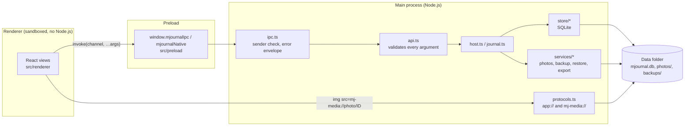

# mJournal architecture

This document is for developers working on mJournal. The [README](../README.md) covers installing and using it.

## Why this stack

mJournal is a desktop **Electron** app with a **React + TypeScript** interface and **SQLite** storage.

- **A designed interface.** The product depends on its look and feel (cream paper, soft type, hand-drawn moods,
  animation that respects reduced motion). HTML and CSS give full control over that, and Electron ships its own
  Chromium, so it renders the same on every machine and works offline.
- **Real local storage without a server.** The main process reads and writes the SQLite file and photo folder
  directly. There is no local web server and no open port; the interface talks to the main process over IPC only.
- **One-click distribution.** `electron-builder` produces a per-user installer and a portable `.exe`.
- **Testable end to end.** Playwright can drive the real app, so the important flows are tested as a user would use
  them.
- **No compiled add-ons.** SQLite comes from Node’s built-in `node:sqlite` (present in Electron 44’s Node 24), so
  `npm ci` never compiles native code, and unit tests run on the very same SQLite engine.

Alternatives considered: Tauri (needs a Rust toolchain, harder to drive with test automation), a localhost server with
the system browser (opens a port that other software could reach, and feels like a website), WPF/WinUI (Windows-only
and much harder to make look designed), Python with pywebview (depends on platform-specific bridges).

## Processes

- `src/core` is pure TypeScript with no Node.js or DOM APIs. It compiles under both the main-process and interface
  configs, so it can’t accidentally depend on either. It holds dates, streak rules, the prompt library and its
  selection, mood definitions, text helpers, input validation and the **API contract** (`core/api.ts`).
- `src/main/journal.ts`, `host.ts`, `store/*` and `services/*` don’t import Electron. Tests open real journals in
  temporary folders, including the complete backup → restore flow.
- Electron-specific code is limited to `main/index.ts`, `window.ts`, `protocols.ts`, `platform.ts`, `ipc.ts` and
  `reminders.ts`.

### The API contract

`core/api.ts` defines `MJournalApi` (typed methods per namespace) and `API_METHODS` (the list of method names, checked
against the interface at compile time). The preload exposes exactly those methods; `main/ipc.ts` registers exactly
those channels; `main/api.ts` implements them, treating every argument as `unknown` and validating it with
`core/validation.ts`. Errors that are safe to show are `UserFacingError`s; anything else is logged (the error only,
never the arguments) and reported as a generic message.

## Data model (schema version 1)

All tables are SQLite `STRICT` tables. The schema version is `PRAGMA user_version`.

| Table | Purpose |
| --- | --- |
| `entries` | One row per calendar day (`date` = `YYYY-MM-DD`): free writing, mood key, mood note, energy 1–5, favorite. Derived columns (`word_count`, `has_text`, `answer_count`, `photo_count`, `favorite_moments`) are refreshed in the same transaction as every change; `has_content` is a generated column and is the single definition of “this day counts”. |
| `answers` | Prompt answers per day, with a copy of the question’s wording (`prompt_text`) so edits to custom prompts never change old answers. |
| `photos` | Photo rows: day, content hash, stored file, caption, order, favorite, thumbnail flag, `removed_at` for “Recently removed”. No foreign key to `entries`, so deleting a day keeps its photos recoverable. |
| `daily_prompts` | The featured question shown for each date (saved on first view), with shuffle count and “skipped”. |
| `prompt_prefs` | Favorite / hidden flags for any prompt id. |
| `custom_prompts` | The user’s own questions (archived rather than deleted). |
| `moods` | The mood vocabulary: label, icon, color, order, hidden, built-in. Moods are hidden, never deleted. |
| `monthly_reflections` | Answers to the monthly questions and the “Dear me” letter, per month. |
| `settings` | JSON values per key, re-validated on read (malformed values fall back to defaults). Keys starting with `internal.` hold things like the window size. |
| `search_index` | FTS5 table (`body`, `answers`, `notes`), rowid = the day number of the date. |

### Migrations

`store/migrations.ts` holds an ordered list of migrations. On start-up:

1. If the database is from a **newer** version, mJournal refuses to open it and changes nothing.
2. If a migration is needed and the database already has data, a full snapshot is written to
   `backups/automatic/mJournal-before-migration-v<N>-<time>.db` first.
3. Each migration runs in its own transaction together with its `user_version` bump. A failure rolls back
   completely.
4. Derived columns and the search index are rebuilt.

**To change the schema:** append a new migration with the next version number. Never edit a released one. Add a
test next to the ones in `tests/unit/migrations.test.ts`.

## Important flows

### Saving while writing

`renderer/lib/saveQueue.ts` debounces edits per field (`body:<date>`, `answer:<date>:<prompt>`, …) for 650 ms, runs
saves for the same field in order, keeps failed saves for retry and drives the save indicator. Before the window
closes, the main process asks the interface to flush (`window.ts`, with a 3-second safety timeout).

SQLite runs in WAL mode with `synchronous = FULL`, so a committed save survives a crash or power cut.

### Photos

1. The main process reads the picked or dropped file (size limit 25 MB), identifies it by its first bytes (JPEG, PNG,
   WebP, GIF, AVIF; HEIC is recognised and politely rejected) and hashes it.
2. The bytes are written atomically to `photos/<first 2 hex>/<sha256>.<ext>` unless that file already exists.
   Identical photos are therefore stored once, and two photos can never collide.
3. The interface fetches the original through `mj-media://photo/<id>`, decodes it with Chromium (respecting EXIF
   orientation), scales it down and sends back a WebP thumbnail, stored as `thumbnails/<sha256>.webp`.
4. Removing a photo sets `removed_at`. Deleting it permanently is a separate, confirmed step, and the file is only
   deleted when no other photo row uses it. Originals on the user’s disk are only ever read.

### Complete backup and restore

- `services/backup.ts → writeBackup` writes `mjournal-backup.json` (manifest with counts and SHA-256 of every file), a
  `VACUUM INTO` copy of the database and every referenced photo into a `.partial` file, flushes it, then renames it
  into place.
- `stageBackup` only accepts entry names from an allowlist, rejects links, encrypted entries, duplicates and oversized
  archives, cross-checks the archive against its manifest, extracts into `.tmp/restore-*` while verifying sizes and
  hashes, then opens the extracted database and runs `PRAGMA integrity_check`.
- `host.ts → restore` closes the journal, moves the current database and photos to
  `backups/previous-journal-<time>/`, moves the staged files in and reopens. If any step fails, every move is undone
  and the original journal is reopened.

### Motion, the welcome guide and tips

- Animations are CSS keyframes in `renderer/styles/motion.css`, imported last. Under reduced motion (the system
  setting, or *Settings → Appearance → Reduce motion*, which adds `reduce-motion` to the root element) the rules at
  the end of `styles/base.css` shorten every animation and transition to 1 ms and drop delays, so nothing ever waits
  on an animation. `renderer/lib/motion.ts` holds the JavaScript side (particle bursts, count-up numbers, the theme
  cross-fade, the slide direction for previous/next) and every helper there does nothing under reduced motion.
- The welcome guide (`renderer/views/Onboarding.tsx`) is a modal `<dialog>` shown while the `onboardingDone` setting
  is false; finishing or skipping it sets the flag. One-time tips (`renderer/components/Tip.tsx`) only appear after
  the guide, and dismissing one adds its id to the `dismissedTips` setting.

## Security model

- Renderer: `sandbox`, `contextIsolation`, no `nodeIntegration`, strict Content-Security-Policy (no inline scripts, no
  remote origins), served from the custom `app://mjournal` scheme rather than `file://`.
- IPC: only the listed channels, only from the app’s own origin, every argument validated.
- Media: `mj-media://photo/<id>` looks files up by id in the database; arbitrary paths can’t be requested. CORS is
  limited to the app origin.
- Navigation, `window.open`, `<webview>` and all permission requests are blocked.
- Packaged app: Electron fuses disable `ELECTRON_RUN_AS_NODE`, `NODE_OPTIONS` and inspector flags, and enforce asar
  integrity and loading only from the asar.
- Logs never contain journal content. There is no telemetry. The only network request is the update check (below);
  the interface itself can’t reach the network at all (its content-security policy allows no remote origins).
- Not done: encryption at rest. Protecting the journal relies on the operating system account and disk encryption.

### The update check

`main/services/updates.ts` (`UpdateChecker`) decides *when*: about 10 seconds after start and then once a day, never
more than daily across restarts (the last answer is kept in the `internal.updateCheck` setting), a few hours after a
failure, and never while *Check for new versions* is off. *Check now* asks right away. `main/index.ts` makes the
request: a plain `GET` of GitHub’s latest-release API from the main process, in its own in-memory session (no cookies,
no cache), with the user agent `mJournal`. `core/updates.ts` compares the version numbers. The app never downloads
anything; *Get it* opens the fixed releases-page address with `shell.openExternal`, never an address taken from the
answer. Development builds don’t check automatically; end-to-end tests point `MJOURNAL_UPDATE_URL` at a local server
(only honoured when the app isn’t packaged).

## Releases

`.github/workflows/release.yml` runs on GitHub Actions when a `vX.Y.Z` tag is pushed (`npm version patch` then
`git push --follow-tags`). On a Windows runner it checks that the tag matches `package.json`, runs `npm ci` and
`npm run verify`, builds with `npm run dist`, writes `SHA256SUMS.txt` and publishes the installer, the portable app
and the checksums with `gh release create`. electron-builder itself never publishes (`publish: null`), so no
auto-update metadata is produced. Running the workflow by hand builds and tests without releasing and keeps the files
as a run artifact.

`THIRD-PARTY-NOTICES.txt` is generated from `node_modules` by `scripts/notices.cjs` (`npm run notices`) and shipped next
to the executable together with `LICENSE`; `tests/unit/notices.test.ts` fails when it is out of date.

## Testing

- `tests/unit` (Vitest, plain Node.js with the same `node:sqlite`): calendar maths across month, year and leap-day
  boundaries; streak rules; prompt library and deterministic selection; entries and answers; moods; settings;
  photos (types, size limit, duplicate names, dedupe, missing files, removal, thumbnails); search and filters; stats;
  JSON and CSV export (including formula escaping); migrations (upgrade, rollback, newer version, unreadable file);
  backup and restore (round trip, cancel, corrupted, truncated, path traversal, absolute paths, links, unexpected
  files, tampered manifest, database or photos); API validation; version comparison and update-check scheduling (with
  fake timers); third-party notices being up to date.
- `tests/e2e` (Playwright driving the built app with a temporary `MJOURNAL_DATA_DIR`): clean start; writing, closing
  the window and reopening; editing earlier days; calendar navigation; photos with duplicate names and thumbnails;
  missing photo files; search and filters; monthly reflection persistence; JSON and CSV export; backup and confirmed
  restore; corrupted backup; theme switching; the welcome guide (with animations on, and in the smallest window);
  one-time tips; the update note (against a local stand-in for GitHub); keyboard-only use. Native dialogs and
  `shell.openExternal` are stubbed in the main process. The other tests run with reduced motion and skip the guide.
  On GitHub Actions each end-to-end test gets one retry.

## How-tos

- **Add a prompt:** append it to the right category in `core/prompts.ts`. Ids are positional within a category, so
  only ever append. Retire a prompt by listing its id in `RETIRED_PROMPT_IDS`, never by deleting it.
- **Add a mood face or symbol:** add the name to `MOOD_ICONS` in `core/moods.ts` and draw it in
  `renderer/components/MoodIcon.tsx`.
- **Change colors or type:** design tokens live in `renderer/styles/tokens.css` (light values on `:root`, dark values
  in the `prefers-color-scheme: dark` block). The window title bar colors are in `core/theme.ts`; keep them in sync
  with `--chrome-bg`.
- **Change the icon:** edit `build/icon.svg` (and `build/icon-small.svg` for 16–24 px), then run `npm run icons`.
- **Add a tip:** place `<Tip id="…">` at the top of a view with a new id (lowercase letters, digits and dashes).
  Never reuse or rename an id: dismissed ids are stored in settings.
